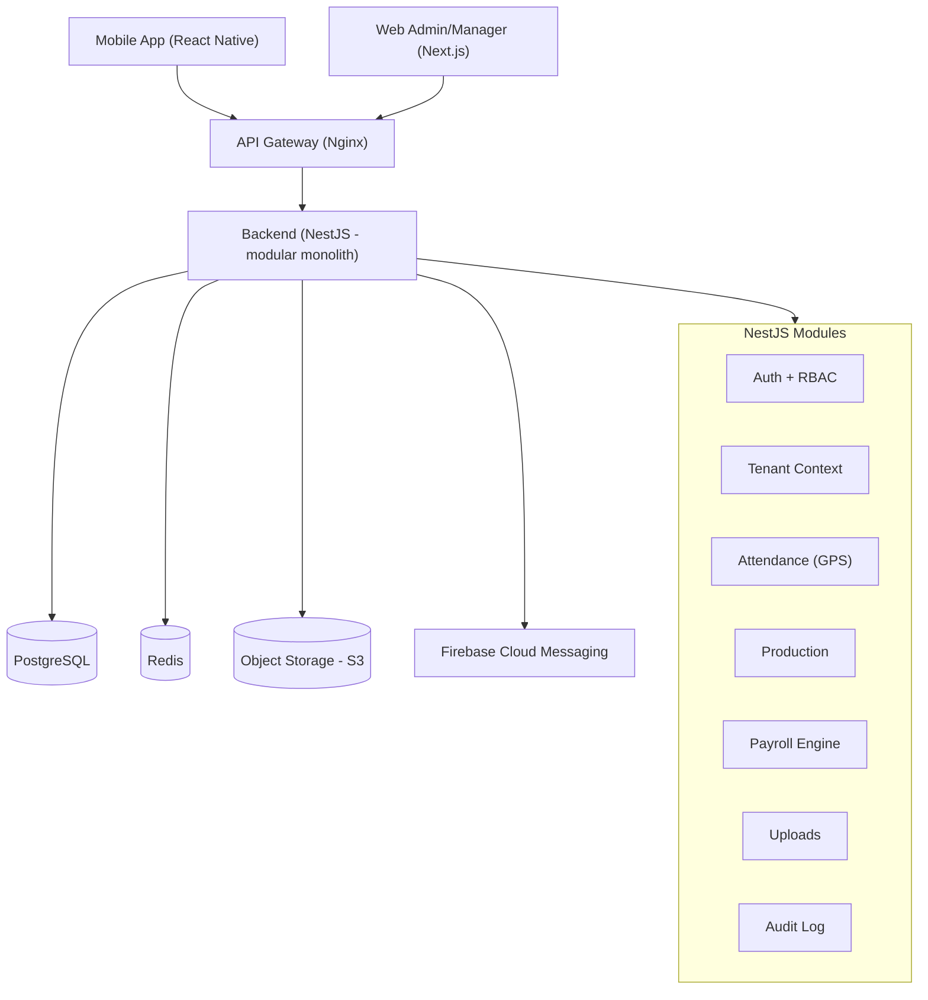
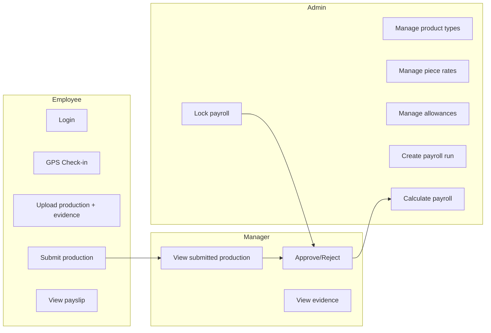
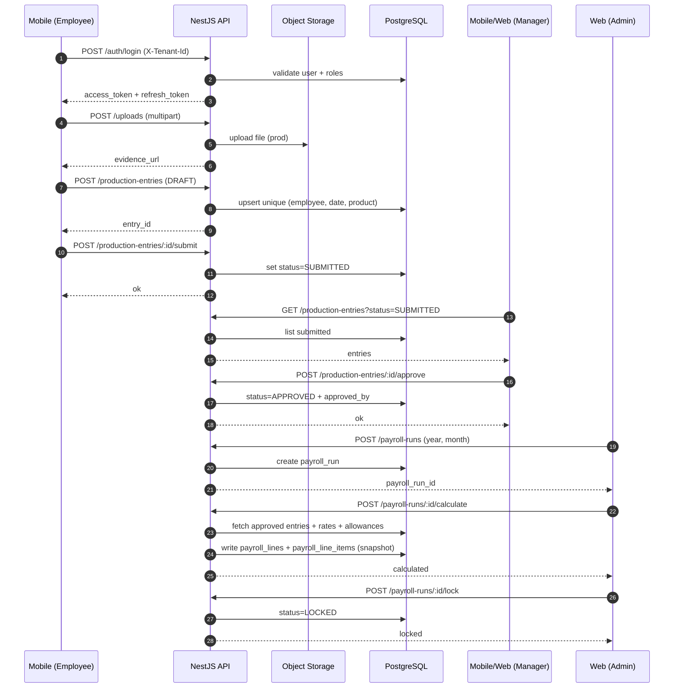
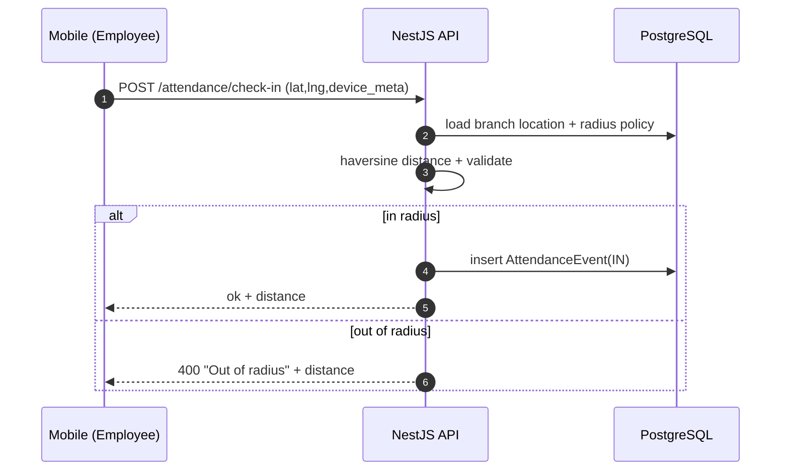
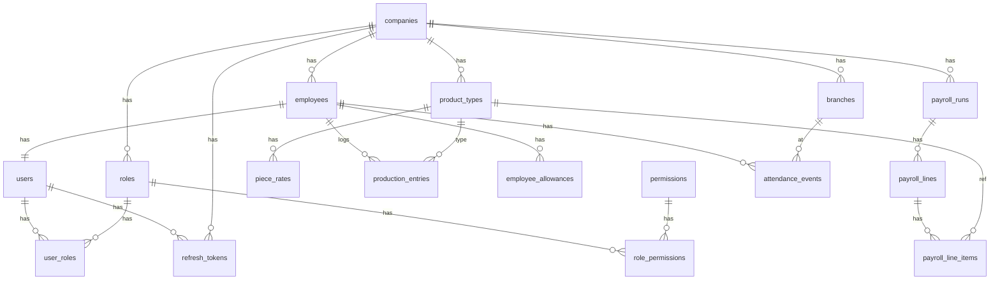

# Diagrams — Use Case / Sequence / ERD / Architecture

## 1) Architecture diagram (prototype)

## 2) Service breakdown (future-ready)
- `auth-service`: login/refresh/logout + RBAC
- `tenant-service`: company config, policies
- `attendance-service`: GPS check-in + anti-fake
- `production-service`: production entries + approval workflow
- `payroll-service`: payroll run + calculate/lock + exports
- `upload-service`: S3 upload + signed URLs
- `notification-service`: FCM push
- `audit-service`: event/audit log

Prototype hiện tại có thể đi theo “microservices-ready monolith” và tách dần.

## 3) Use case diagram (high level)

## 4) Sequence — Upload sản lượng → Duyệt → Tính lương

## 5) Sequence — GPS Check-in

## 6) ERD (core)

